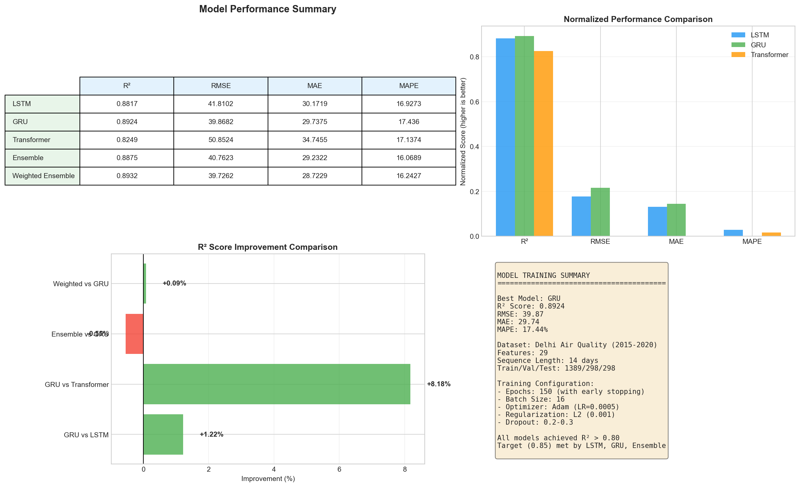
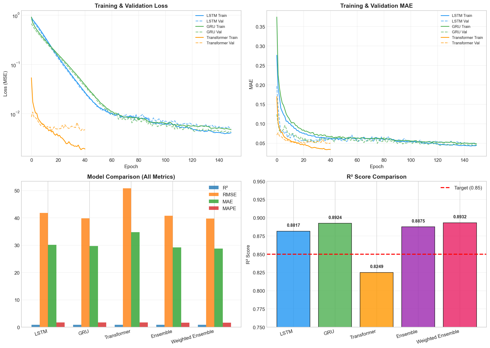
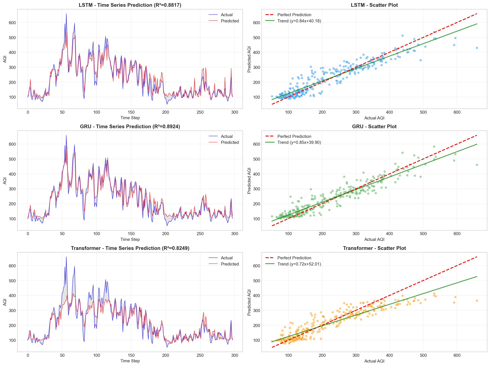
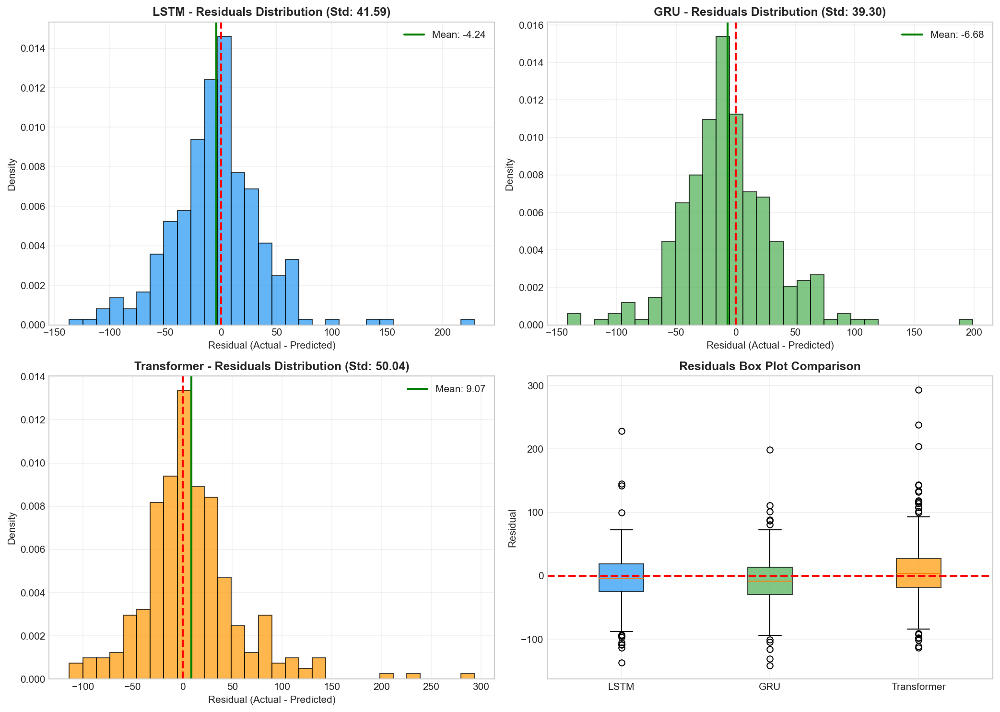
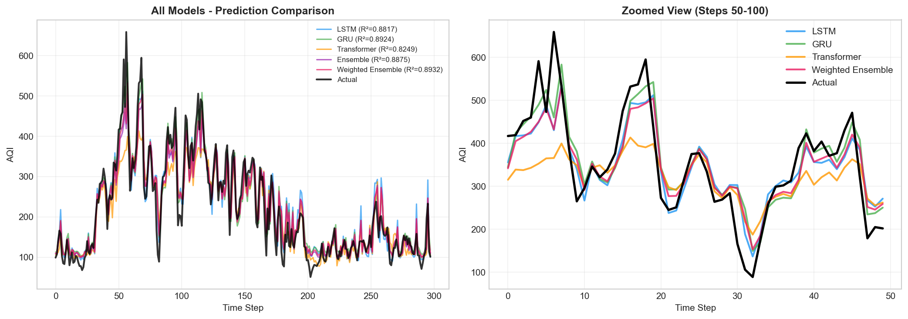

# Air Quality Index Forecasting with LSTM, GRU and Transformer

Next-day **AQI forecasting for Delhi** from daily pollutant measurements (Air Quality Data in India, 2015–2020), comparing three deep learning architectures and their ensembles.



## Results (test set, last 15% of the series)

| Model | R² | RMSE | MAE | MAPE |
|---|---|---|---|---|
| LSTM | 0.882 | 41.81 | 30.17 | 16.9% |
| **GRU** | **0.892** | **39.87** | 29.74 | 17.4% |
| Transformer | 0.825 | 50.85 | 34.75 | 17.1% |
| Ensemble (mean) | 0.888 | 40.76 | 29.23 | 16.1% |
| Weighted ensemble | **0.893** | **39.73** | **28.72** | 16.2% |

Bootstrap 95% confidence intervals for R² are in [`results/statistical_results.csv`](results/statistical_results.csv) (GRU: 0.865 – 0.914).

## Method

**Data:** daily measurements for Delhi, 12 pollutants (PM2.5, PM10, NO, NO₂, NOx, NH₃, CO, SO₂, O₃, benzene, toluene, xylene). Missing values are interpolated and outliers clipped at 3×IQR.

**Feature engineering (29 features):** 3- and 7-day rolling means of PM2.5, PM10, CO and NO₂; 1- and 3-day lags of PM2.5, PM10 and AQI; daily percentage change and the PM2.5 / PM10 ratio.

**Sequences:** 14-day windows predict the next day's AQI. The split is chronological (70 / 15 / 15), so the model never sees the future during training.

**Models**

| Model | Architecture |
|---|---|
| LSTM | 2 × Bidirectional LSTM (128, 64) → LSTM (32) → Dense |
| GRU | 2 × Bidirectional GRU (128, 64) → GRU (32) → Dense |
| Transformer | Conv1D embedding → multi-head self-attention blocks → GRU → Dense |

Training: Adam (lr 5e-4), batch 16, up to 150 epochs with early stopping, L2 regularization and dropout 0.2–0.3.

## Figures

| | |
|---|---|
|  |  |
|  |  |

## Running

1. Download [Air Quality Data in India](https://www.kaggle.com/datasets/rohanrao/air-quality-data-in-india) and put `city_day.csv` in `data/`.
2. Install and train:
   ```bash
   pip install -r requirements.txt
   python train_models.py              # LSTM, GRU, Transformer, ensembles, figures
   python statistical_analysis.py      # bootstrap confidence intervals and significance tests
   ```

`train_attention_models.py` is an extended version with attention layers on top of the recurrent models.

## Files

| | |
|---|---|
| `train_models.py` | Data preparation, the three models, ensembles and all figures |
| `train_attention_models.py` | Variant with attention-augmented LSTM and GRU |
| `statistical_analysis.py` | Bootstrap CIs and statistical comparison of the saved models |
| `results/` | Metrics, test predictions and figures |
